# Equal length is not equal delay

A differential pair that turns through a U-bend comes out of it with one trace shorter than the other. The usual
fix is a serpentine on the short trace that adds the missing length back. A recent illustration of this made the
rounds ([@CorneliusWrites on X](https://x.com/CorneliusWrites/status/2110776676795953595)): at a 20 mil pitch the
inner trace arrives about 9.5 ps early, and about 1.6 mm of serpentine puts it back in step.

The geometry in that picture is right. What it takes for granted is the step from equal *length* to equal
*delay*. We wanted to know how good that step is, so we built the bend and six ways of tuning it, solved each one
as a full four-port in a field solver, and looked at what arrives at the receiver.

In short: **tuning that makes the two traces exactly equal in length left {skew_F} to {skew_D} ps of the
original {skew_B} ps.** The worst offender was the densest accordion. A transmission-line model given the same
lengths predicted less than 1 ps.

## The bend is what geometry says

Two concentric arcs that turn through 180 degrees differ in length by π times their spacing, whatever the radius.
At s = 0.508 mm (20 mil) that is {dl} mm, or {dl_mil} mil. Multiply by √ε_eff / c and you have the skew.

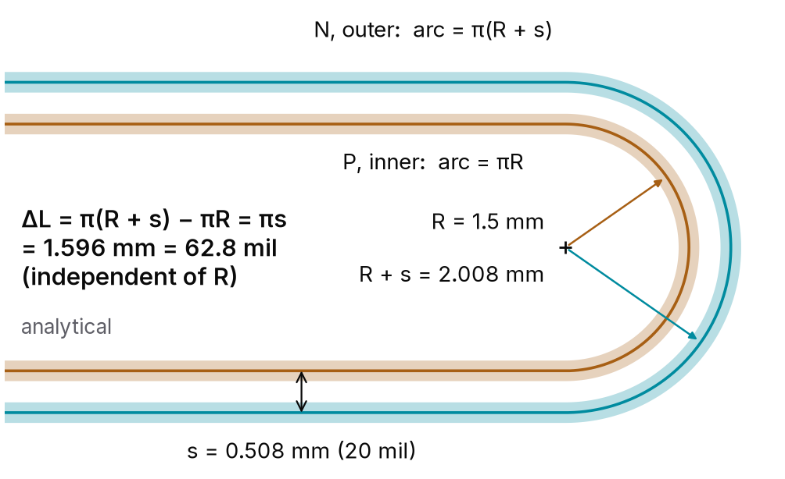

The answer depends on which ε_eff you use. At ε_eff = 3.8 it is {skew_38} ps; the 9.5 ps in the illustration
corresponds to ε_eff = {eps_95}. Our stackup (0.2 mm of ε_r 4.3 under 0.25 mm traces) has a single-line
ε_eff of {eps_single} by the Hammerstad–Jensen closed form, which gives **{skew_single} ps**. The field solver
says **{skew_B} ps**. For the untuned bend, geometry is within {bend_err} %.

## Six ways to fix it, one fixture

Every variant below shares the same stackup, the same launches and the same 12 mm legs. Only the tuning changes.
In C, D and F the amplitude of the excursions is solved so that P and N come out *exactly* equal in centreline
length, chamfered corners included. E is a control: both traces swing out together, which adds delay to the pair
but leaves the difference between them alone.

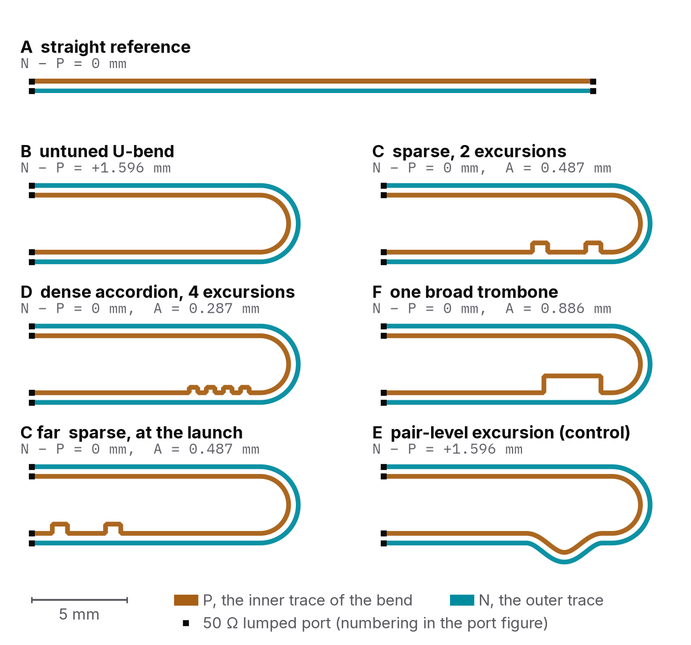

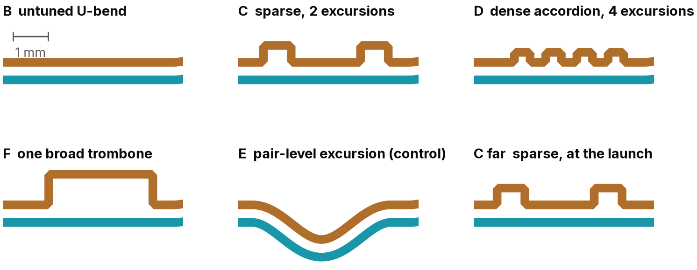

Each variant is four runs of [openEMS](https://docs.openems.de/en/latest/intro.html), one per excited port, with
50 Ω lumped ports at each trace end. That gives a full 4×4 S-matrix, which
[scikit-rf](https://scikit-rf.readthedocs.io/en/latest/api/generated/skrf.network.Network.se2gmm.html) turns into
mixed-mode parameters, and a differential step with a 50 ps edge turns into the waveforms at the far end. In all
we made {runs} solver runs. The untuned bend and two of the tunings were also solved on finer and coarser meshes:
the bend's skew moves by ±{unc_B} ps between them, C's by ±{unc_C} ps, and the dense accordion's, whose
features are the smallest, by ±{unc_D} ps.

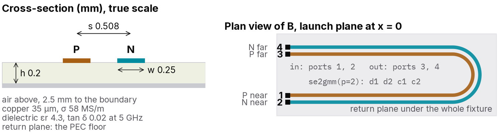

## Matching the lengths does not match the delay

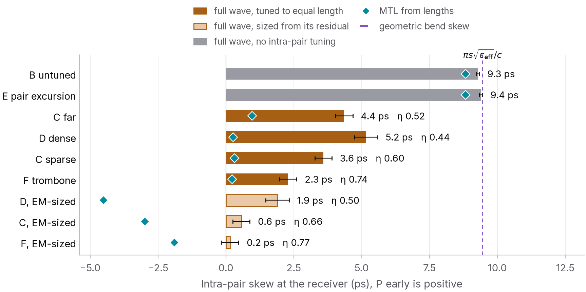

| Variant | What it is | Skew left | Share of the bend's skew removed |
| --- | --- | --- | --- |
| B | untuned bend | {skew_B} ps | none |
| F | one broad trombone | {skew_F} ps | {removed_F} % |
| C | two sparse excursions | {skew_C} ps | {removed_C} % |
| C far | the same, at the launch | {skew_Cfar} ps | {removed_Cfar} % |
| D | dense accordion, four excursions | {skew_D} ps | {removed_D} % |
| E | pair-level excursion | {skew_E} ps | none, by design |

Every tuned variant has P and N exactly the same length, and every one still lets P arrive first. The waveforms
show it directly:

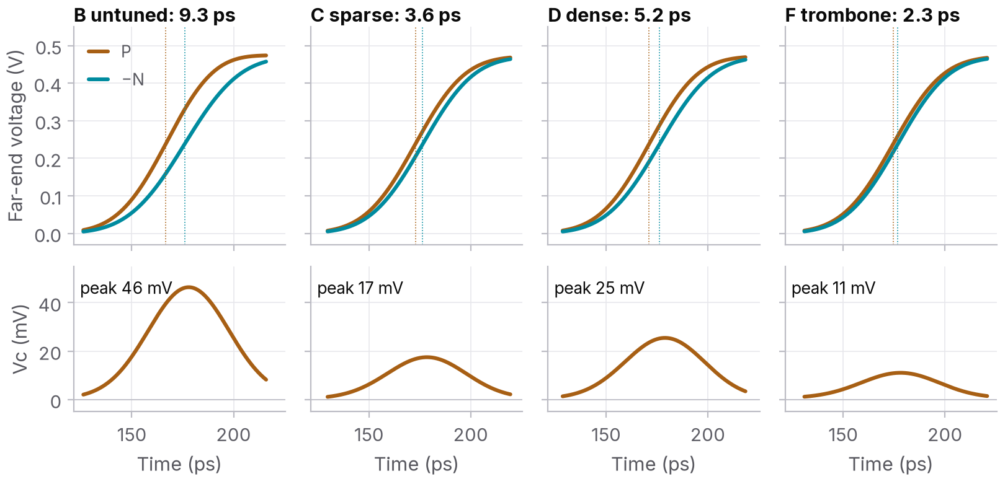

The more excursions, the less of the skew comes back. One excursion removed {removed_F} %,
two removed {removed_C} %, four removed {removed_D} %.

## Where the delay goes

We built a two-conductor transmission-line model of every variant, calibrated on the solver's own straight pair,
so its coupled lines are the solver's coupled lines. It knows every length exactly. It predicts {mtl_F}, {mtl_C}
and {mtl_D} ps for F, C and D. So length is not what is missing. What the line model does not know is the
corners of each excursion and the coupling between its folds.

To pull those two apart we ran one more experiment: a straight pair with 6 mm added to one trace in three
excursions, once with the folds 1.0 mm apart and once 0.15 mm apart (our clearance rule). Same corners, same added
length. We define a delay efficiency η as the delay the tuning actually adds, divided by what its length predicts.

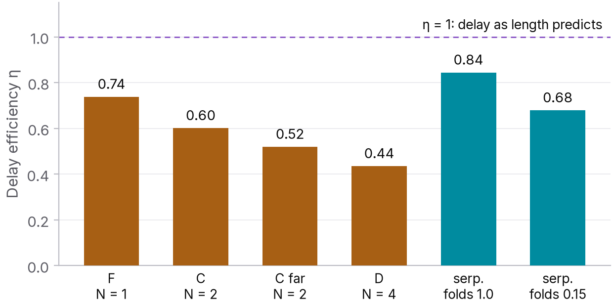

With loose folds η = {eta_Sloose}. Packing the folds to the clearance rule took it to {eta_Stight}, and on every
mesh we tried the tight folds came out {fold_pen_min} to {fold_pen_max} points lower: that is the
fold coupling that [Wu and Chao](https://doi.org/10.1109/96.475270) and
[Rubin and Singh](https://doi.org/10.1109/22.868994) described for single-ended meanders. The loose serpentine's
own shortfall we attribute to its corners. In the bend corrections each excursion cost {per_exc_min} to
{per_exc_max} ps of delay that its length says it should have added. That cost does not shrink with the
excursion's size, so a fix made of many small excursions under-delivers the most.

## Stripline does the same

Microstrip has two propagation velocities, one per mode, so it was fair to ask whether all this is a microstrip
quirk. We put the same copper between two planes and solved it again. Stripline is homogeneous, and geometry
predicts its bend to {bend_err_sl} % ({skew_Bsl} ps against {skew_geo_sl} ps). The length-matched tunings
removed {removed_Fsl}, {removed_Csl} and {removed_Dsl} % of the skew, close to microstrip's {removed_F},
{removed_C} and {removed_D} %. Tight folds still cost {fold_pen_sl} points of efficiency. We had expected that to
shrink, since far-end coupling between parallel lines vanishes in stripline. It did not: adjacent folds carry
current in opposite directions, so the coupling that shortcuts them is backward coupling, and stripline has that
too.

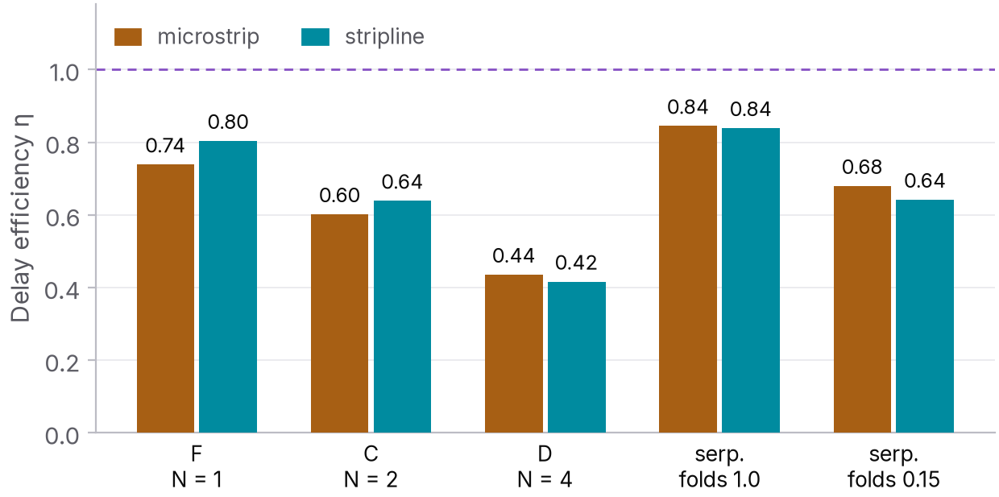

## Where you put it matters at high frequency

C far is the same tuning as C, moved next to the launch. Its arrival skew is similar ({skew_Cfar} ps against
{skew_C} ps). Its mode conversion is not: between the tuning and the bend the pair carries skew the other way, and
the two corrections drift out of phase as frequency rises. Read as a skew, C far's grows from {fd_Cfar_5} ps at
5 GHz to {fd_Cfar_25} ps at 25 GHz, while C stays flat.

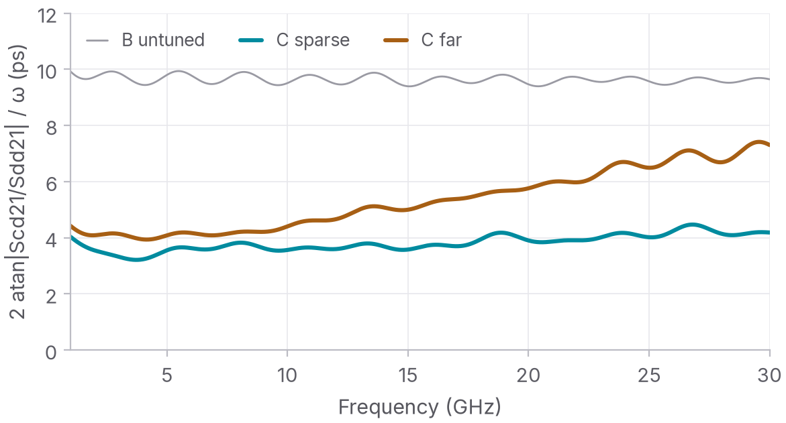

## The trombone pays in impedance

The broad trombone removed the most skew, but its trace leaves its partner for 3 mm, and the differential
impedance there rises to {zmax_F} Ω against {zmax_B} Ω for the plain bend. Its return loss is the worst of the set
({sdd_F} dB against {sdd_B} dB).

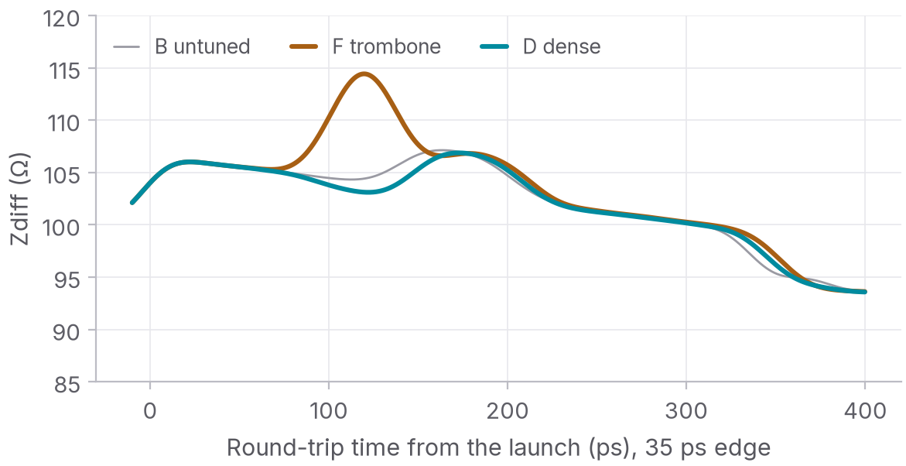

## What 9 ps of skew does to a signal

At 16 Gb/s with 35 ps edges, the untuned bend closes the differential eye from {eyeh_A} % to {eyeh_B} % of the
swing. That is small. What it does more of is turn the signal into common mode: {eyevc_B} % of the swing peak to
peak at the receiver, against {eyevc_F} % for the trombone and {eyevc_C} % for C. A receiver with good common-mode
rejection will not notice the timing. Whether the common mode becomes an emissions problem depends on the rest of
the board, which this study does not model.

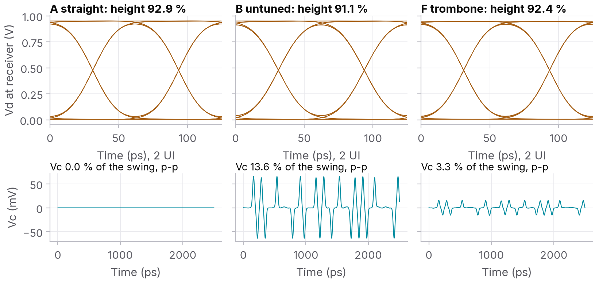

## Sizing the tuning by its effect

If each excursion loses a fixed amount, the fix is to add that amount back. We lengthened C, D and F by their own
residual, converted to length at the rate the bend shows. By CAD measure P is now longer than N, and a length-based model says these versions overshoot, to
{mtl_Fcal} ps for the trombone, {mtl_Ccal} ps for C and {mtl_Dcal} ps for D. In the solver the skew became {skew_Fcal} ps for the trombone and {skew_Ccal} ps for C: one iteration was enough. The dense
accordion came down only to {skew_Dcal} ps. Lengthening its tightly packed verticals also strengthens the coupling
between them, so each extra millimetre delivered {marg_D} % of the delay it should have, against {marg_C} % for C
and {marg_F} % for the trombone. A dense accordion needs a second iteration; a sparse or broad one is calibrated
by one field solution, or one set of coupons, per stackup.

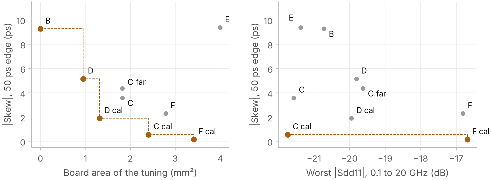

## Rules of thumb

For edge-coupled pairs at about this pitch, in microstrip or stripline, and with the caveat that these are
simulations:

- Trust geometry for the bend. Do not trust it for the fix: budget a residual of a few picoseconds, or size the
  tuning from a field solution or a coupon.
- Use few excursions. Each one costs delay in its corners whatever its size.
- Keep the folds apart. At the clearance rule the folds cost {fold_pen_min} to {fold_pen_max} points of efficiency.
- Tune next to the mismatch, not at the end of the route.
- Keep a broad excursion short, or it shows up in the TDR.
- Swinging the whole pair out does not fix intra-pair skew.
- None of this goes away in stripline.

## What this is and is not

Everything above is simulated: one width and one pitch in one microstrip and one stripline stackup, lumped
ports, perfect return planes and a conducting-sheet copper model. Nothing was built or measured. The full report covers the method, the mesh
convergence, the numerical checks, a coupon plan to test these
predictions on hardware, and the limitations.

The report, the scripts, the S-parameter files and every figure are in the study's repository. Every number in
this post is read from the simulation results by a script, not typed in.
